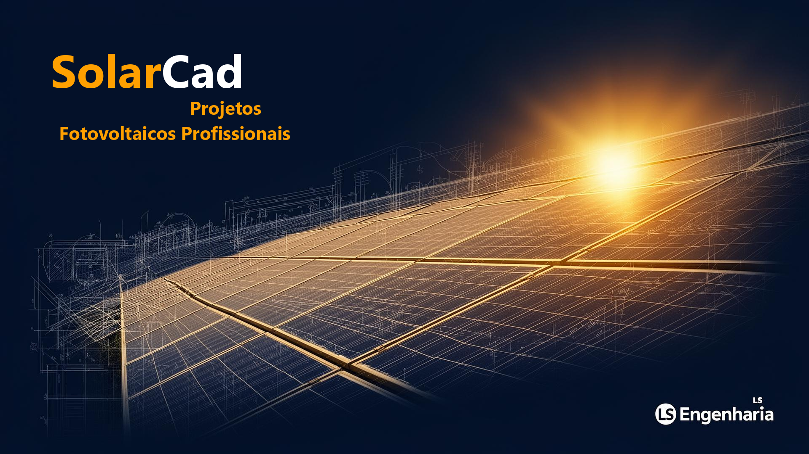
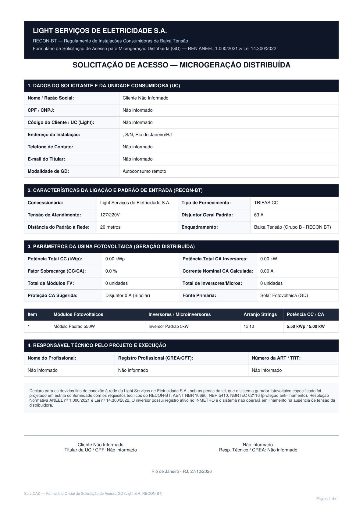
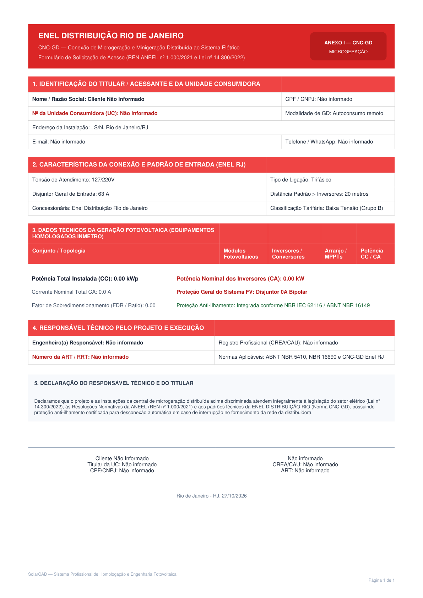
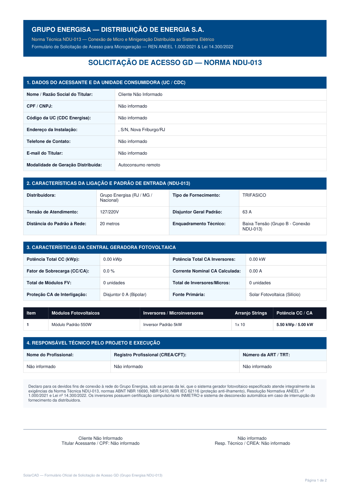
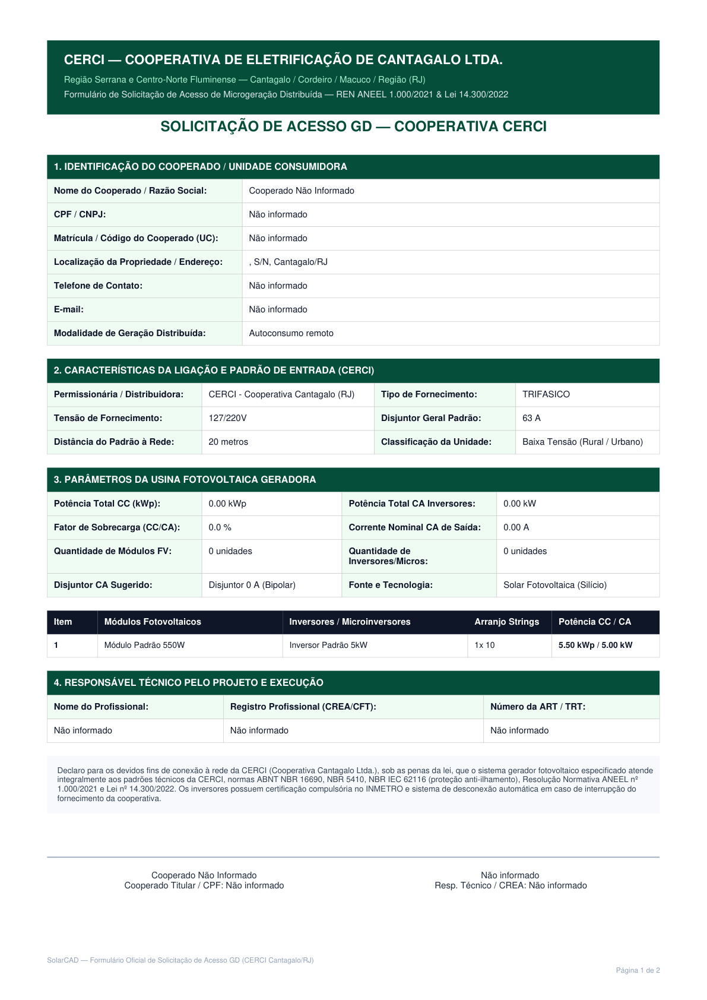
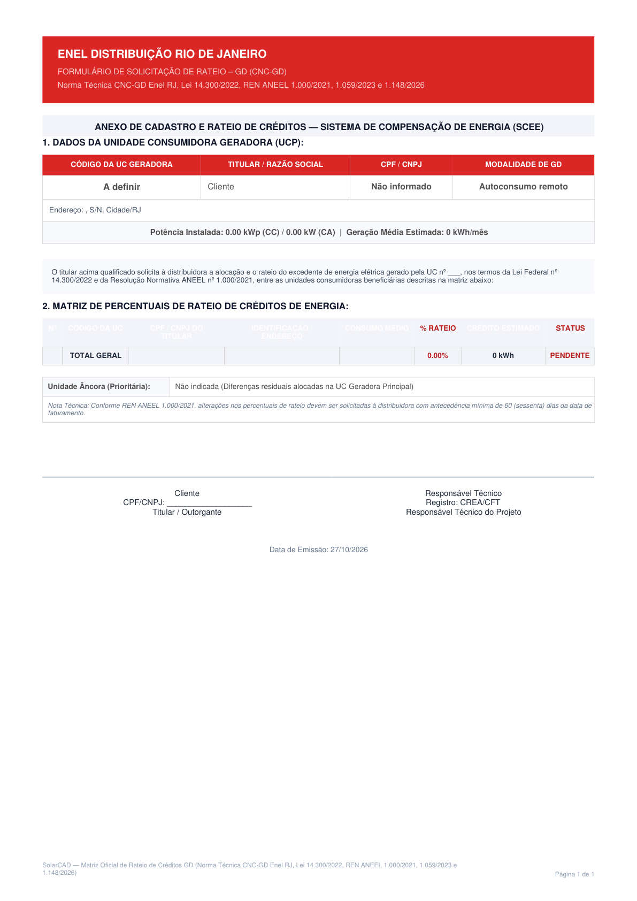
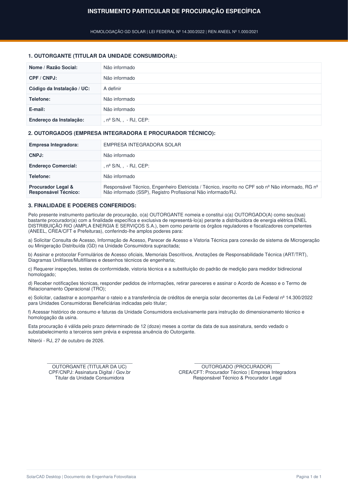

# ☀️ SolarCad — Enterprise Photovoltaic CAD & Utility Homologation Suite

<div align="center">

[](https://www.linkedin.com/in/lucasantannaeng)
[]()
[]()
[](https://www.typescriptlang.org/)
[](https://reactjs.org/)
[](https://www.electronjs.org/)
[](https://vitejs.dev/)
[](https://tailwindcss.com/)
[](https://vitest.dev/)
[]()
[]()

<br />

> **Enterprise-grade Computer-Aided Design (CAD) & Sizing Suite for Solar PV Single-Line Diagrams (SLD), regulatory compliance (NBR 5410 & NBR 16690), automated Utility Access Forms (ENEL, LIGHT, CERCI, ENERGISA), Marco Legal da GD (Lei 14.300) rateio generation, and AutoCAD DXF / PDF export.**

<br />



</div>

---

## 🌟 Overview & Engineering Value Proposition

In Brazilian solar photovoltaic contracting and distributed generation (GD) grid access, engineering teams routinely lose hours redrawing Single-Line Diagrams (SLD) in AutoCAD, manually performing temperature-corrected voltage calculations, and retyping client metadata across fragmented utility distributor PDFs and Excel sheets.

**SolarCad** is a high-productivity engineering workstation engineered to eliminate document rejection (*glosas técnicas*) and streamline the entire grid connection workflow:

* ⏱️ **Dramatic Time Reduction:** Drops complete engineering dossier preparation time from **~60 minutes per client to under 15 minutes**.
* 📐 **Interactive Multi-Mode Vector CAD:** Real-time parametric 2D canvas supporting Single-Line, 3-Phase Multi-Wire, and RS-485 Modbus RTU communication schematics.
* ⚡ **Deterministic Regulatory Compliance:** Built-in calculation core enforcing **ABNT NBR 5410** (low-voltage electrical installations), **ABNT NBR 16690** (photovoltaic design & protection), **ABNT NBR 5419** (grounding), and **Marco Legal da GD (Lei Federal 14.300/2022)**.
* 🏛️ **Official Utility Automation:** One-click automated generation of official regulatory forms and credit allocation spreadsheets for major Brazilian energy distributors (**Light S.A.**, **Enel Distribuição RJ**, **Energisa**, and **CERCI**).
* 📄 **AutoCAD & High-Resolution Dossiers:** Direct export to industry-standard **AutoCAD DXF R12** with named layer blocks and multi-page executive PDF dossiers with CREA-RJ endorsement.

---

## 🎬 Product Tour & Demonstration Video (50s)

<div align="center">

https://github.com/lucasantannaeng/SolarCad/raw/main/assets/solarcad-demonstration.mp4

<br />

*Demonstração executiva do fluxo de trabalho no SolarCad Suite v1.3.9: do dimensionamento fotovoltaico determinístico NBR 16690 e CAD vetorial à geração automática de formulários oficiais das distribuidoras (Light, Enel, Energisa, CERCI) e exportação AutoCAD DXF.*

</div>

---

## 📸 Application Showcase & Interactive Demonstrations

### 1. Multi-Mode Interactive CAD Canvas (`DiagramCanvas.tsx`)

The vector CAD workspace delivers instant, interactive pan & zoom (40% to 300%) with seamless switching between A4/A3 sheet viewports and three dedicated engineering drawing modes:

```
┌────────────────────────────────────────────────────────────────────────────────────────┐
│                                 SOLARCAD CAD MODES                                     │
├──────────────────────────┬─────────────────────────────┬───────────────────────────────┤
│ Mode 1: SLD (Unifilar)   │ Mode 2: Multi-Wire (Trifilar)│ Mode 3: Communication (Modbus)│
├──────────────────────────┼─────────────────────────────┼───────────────────────────────┤
│ • Normalized NBR symbols │ • R-S-T Individual Phases   │ • Daisy-Chain RS485 Topology  │
│ • PV String Array & FDI  │ • Neutral & PE Conductors   │ • Shielded Pair (STP 2x24AWG) │
│ • DC String Box & Fuses  │ • Conductor Gauge & Colors  │ • 120Ω End-of-Line Resistors  │
│ • AC Switchboard (QDS)   │ • Terminal Block Details    │ • Smart Meter & CT Toroids    │
│ • Utility Revenue Meter  │ • Voltage Drop Verification │ • Inverter Port Configuration │
└──────────────────────────┴─────────────────────────────┴───────────────────────────────┘
```

* **Dynamic Dimensioning & Zoom-to-Fit:** Automatically scales viewports to the exact installation boundaries.
* **AutoCAD Layered DXF Export:** Compiles vector paths into standard DXF blocks (`BLOCK_INVERSOR`, `BLOCK_DISJUNTOR`, `BLOCK_MEDIDOR`, `BLOCK_STRINGBOX`), allowing opening in Autodesk AutoCAD, LibreCAD, and BricsCAD without missing entity warnings.

---

### 2. Multi-Utility Grid Access Suite (Homologação GD)

SolarCad maps project parameters directly to official distributor submission templates, generating standardized PDF forms without manual transcription errors:

<div align="center">

| Light S.A. (RECON-BT) | Enel Distribuição RJ (CNC-GD) |
| :---: | :---: |
|  |  |
| *Anexo Técnico de Microgeração BT (RECON-BT)* | *Formulário Oficial de Solicitação de Acesso GD* |

| Energisa (NDU-013) | CERCI Cooperativa |
| :---: | :---: |
|  |  |
| *Norma de Distribuição Unificada NDU-013* | *Formulário de Homologação Rural e Regional* |

</div>

---

### 3. Marco Legal da GD (Lei 14.300/2022) & Rateio de Créditos

The system integrates an automated credit allocation matrix, calculating remote self-consumption (*autoconsumo remoto*) and shared generation credits (*geração compartilhada*) across beneficiary consumer units (UCs):

<div align="center">



*Matriz Executiva de Rateio entre UCs Beneficiárias (Layout Oficial Lei 14.300/2022)*

</div>

* **Fio B Progressive Phase-in Engine:** Computes tariff impacts according to ANEEL regulations:
  * 2023: 15% | 2024: 30% | 2025: 45% | **2026: 60%** | 2027: 75% | 2028: 90% | 2029+: 100%.
* **Binary Spreadsheet Generation:** Directly generates and formats `.xlsm` macro-enabled workbooks expected by distributor inspection portals.

---

### 4. Executive Legal & Commercial Documentation

Eliminates back-and-forth delays with notary public requirements by automatically generating tailored, single-page Powers of Attorney (*Procuração Específica*) and commercial contracts compliant with **REN ANEEL 1.000/2021**:

<div align="center">



*Procuração Específica em Folha Única com Alíneas de Representação Desobstruídas (Template Modelo do Motor)*

</div>

* **Unobstructed Signature Space:** Strict layout protection guaranteeing that signee fields are never orphaned across page breaks.
* **Scope-Specific Powers:** Pre-drafted clauses for distributor access request, technical inspection attendance, meter replacement, and administrative appeals.

---

## ⚡ Engineering Specifications & Calculation Core

```
                         ┌─────────────────────────────┐
                         │   Solar Radiation & Tilt    │
                         │   (CRESESB / INMET Database)│
                         └──────────────┬──────────────┘
                                        ▼
┌───────────────────────┐   ┌───────────────────────────┐   ┌───────────────────────┐
│   String Optimization │   │   Electrical Protections  │   │   Grid Interconnection│
│   • Voc,max @ Tmin    │──▶│   • gPV Fuses (1.5 x Isc) │──▶│   • AC Breaker Sizing │
│   • Vmp,min @ Tmax    │   │   • DC Isolator Switch    │   │   • Cable Voltage Drop│
│   • Overpowering/FDI  │   │   • Type II Surge (1000V) │   │   • NBR 5410 FCT & FCA│
└───────────────────────┘   └───────────────────────────┘   └───────────────────────┘
```

### Deterministic Thermal Voltage Sizing (NBR 16690)
$$V_{oc,max} = V_{oc,STC} \cdot \left[1 + \frac{\beta_{Voc}}{100} \cdot (T_{min} - 25^\circ\text{C})\right]$$

$$V_{mp,min} = V_{mp,STC} \cdot \left[1 + \frac{\gamma_{Pmp}}{100} \cdot (T_{max} - 25^\circ\text{C})\right]$$

* **Inverter Protection Guarantee:** Enforces $N_{modules} \cdot V_{oc,max} \le V_{max,inverter}$ to eliminate inverter overvoltage shutdowns during winter mornings.
* **MPPT Voltage Window Assurance:** Verifies $N_{modules} \cdot V_{mp,min} \ge V_{min,MPPT}$ under extreme summer irradiance conditions.

---

## 🛠️ Tech Stack & Engineering Standards

| Domain | Technologies |
| :--- | :--- |
| **Frontend Framework** | React 18.3, TypeScript 5.8, Tailwind CSS 3.4, Lucide Icons |
| **Desktop Runtime** | Electron 44 (Context Isolated, Sandboxed IPC Architecture) |
| **CAD & Vector Graphics** | HTML5 Canvas 2D, Custom DXF R12 Serializer (Named Layer Blocks) |
| **Document Processing** | jsPDF, jspdf-autotable, SheetJS / ExcelJS (Macro-enabled .xlsm) |
| **Cloud & Database** | Supabase (PostgreSQL 15+, Row-Level Security, Edge Functions) |
| **AI OCR & Validation** | Google Gemini (Multimodal Energy Bill OCR & Datasheet Analysis) |
| **Testing & Quality** | Vitest (325 Automated Unit & Regression Tests), TypeScript (`tsc --noEmit`) |

---

## 📋 Supported Energy Distributors (Concessionárias)

| Distributor | Coverage Area | Regulatory Standard | Automated Forms & Deliverables |
| :--- | :--- | :--- | :--- |
| **Light S.A.** | Rio de Janeiro / Baixada | RECON-BT | Anexo A (Microgeração), Memorial Descritivo, Diagrama Unifilar |
| **Enel Distribuição RJ** | Niterói, Região dos Lagos, Norte | CNC-GD | Formulário de Acesso GD, Planilha de Rateio Oficial (.xlsm) |
| **Energisa Minas-Rio** | Interior RJ / Zona da Mata MG | NDU-013 | Formulário de Solicitação de Acesso e Memorial de Proteções |
| **CERCI** | Região Serrana & Cooperativas | Padrão Cooperativo | Requerimento Técnico e Estudo de Carga Rural |

---

## 🏗️ Solution Architecture

```
SolarCad/
├── Core CAD Engine             # 2D Vector Canvas, Pan/Zoom, DXF R12 Block Serializer
├── Electrical Sizing Core      # NBR 5410 ampacity, NBR 16690 thermal voltage, NBR 5419 grounding
├── Utility Access Engine       # Distributor-specific layout engines (Light, Enel, Energisa, CERCI)
├── Document Generation Suite   # High-density PDF memorials, executive PoAs, commercial proposals
├── Tariff & Credit Matrix      # Lei 14.300/2022 progressive Fio B calculation & Excel generator
└── Desktop & Cloud Pipeline    # Hardened Electron runtime, PWA web client, Supabase RLS backend
```

---

## 💼 Engineering Services & Commercial Inquiries

If you are a **solar EPC contractor, engineering consultancy, or project integrator**, professional services and technical responsibility endorsement powered by the **SolarCad** suite are available:

1. **Complete Photovoltaic Grid Connection Projects (Micro & Minigeração):**
   - Executive Single-Line and Multi-Wire diagrams with calculation memorials.
   - End-to-end grid submission and monitoring in distributor portals.
   - Credit rateio optimization for remote consumption and consortiums.
2. **Technical Responsibility Endorsement (ART / CREA-RJ):**
   - Official ART registration for design, execution, and commissioning.
3. **Regulatory Diagnostics & Overcoming Distributor Rejections:**
   - Technical corrections and appeals against unjustified utility grid refusals (*glosas/reprovações*).

---

## 👤 Technical Authority & Contact

**Luca Rodrigues Gomes de Sant'Anna**  
*Mechanical Engineer — CREA-RJ: 2026104562 | RNP: 2024137695*  
Graduation: Instituto Federal Fluminense (IFF Cabo Frio)  

- 📧 **Email:** [lucasantannaeng@gmail.com](mailto:lucasantannaeng@gmail.com)  
- 💼 **LinkedIn:** [linkedin.com/in/lucasantannaeng](https://www.linkedin.com/in/lucasantannaeng)  
- 🐙 **GitHub:** [github.com/lucasantannaeng](https://github.com/lucasantannaeng)  

---

## 📄 Intellectual Property & Commercial Rights

The source code, automation engines, proprietary calculation algorithms, and distributor submission parsers of the SolarCad workstation constitute **proprietary intellectual property** of the author. This repository serves as a public technical showcase, engineering portfolio, and specification reference. For licensing or partnership inquiries, contact the author directly.
